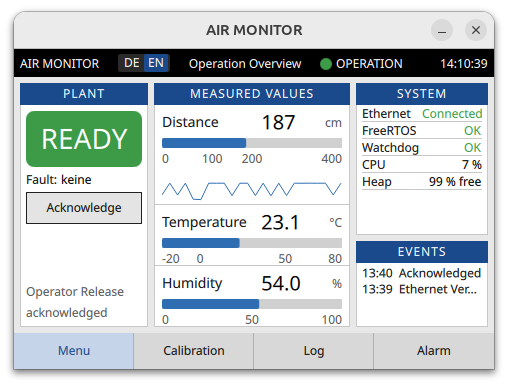

# AIR MONITOR

**Industrial 480×320 Qt/QML HMI** for live air & proximity telemetry over Ethernet — Jetson Orin Nano operator panel ↔ STM32F756ZG.

<p align="center">
  
</p>

<p align="center">
  
  
  
  
  
</p>

---

## Why this project

A compact **operator-grade** panel — not a demo toy dashboard:

- Fixed **480×320** industrial layout (DE / EN)
- **LIVE by default** — real STM32 JSON over TCP (optional `--demo`)
- Distance **0–400 cm** with sparkline, temperature & humidity bars
- Plant state, severity (SAFE / WARN / FAULT), acknowledge path
- System health: Ethernet · FreeRTOS · Watchdog · CPU · Heap
- Event log and alarm / calibration pages

---

## Architecture

```text
┌─────────────────────┐         TCP :5000          ┌──────────────────────┐
│  STM32F756ZG        │  ──── JSON lines (LF) ───► │  Jetson Orin Nano    │
│  sensors + FreeRTOS │  ◄──── ACK\\n ───────────── │  air_monitor (Qt 6)  │
│  192.168.10.2       │                            │  192.168.10.10       │
└─────────────────────┘                            └──────────────────────┘
```

| Role | Stack |
|------|--------|
| UI | Qt 6 Quick / QML · CMake · Ninja |
| Link | `QTcpSocket` · JSON (CSV fallback) |
| Host | NVIDIA Jetson Orin Nano (aarch64) |
| Edge | STM32F756ZG Ethernet telemetry |

---

## Quick start (Jetson)

```bash
export PATH="$HOME/Qt/Tools/CMake/bin:$HOME/Qt/Tools/Ninja:$PATH"
export CMAKE_PREFIX_PATH="$HOME/Qt/6.11.2/gcc_arm64"

cmake -S "$HOME/SensorDashboard" -B "$HOME/SensorDashboard/build" -G Ninja -DCMAKE_BUILD_TYPE=Release
cmake --build "$HOME/SensorDashboard/build"

# One-time: static IP on Jetson Ethernet (same subnet as STM32)
bash "$HOME/SensorDashboard/scripts/setup-jetson-eth.sh"

# LIVE UI — real board data
"$HOME/SensorDashboard/build/air_monitor" --host 192.168.10.2 --port 5000
```

Offline UI only:

```bash
"$HOME/SensorDashboard/build/air_monitor" --demo
```

### CLI

| Flag | Meaning |
|------|---------|
| *(default)* | LIVE Ethernet mode |
| `--host <ip>` | STM32 IP (default `192.168.10.2`) |
| `--port <n>` | TCP port (default `5000`) |
| `--demo` | Local demo values, no socket |

---

## Network

| Device | Address |
|--------|---------|
| Jetson `enP8p1s0` | `192.168.10.10/24` |
| STM32F756ZG | `192.168.10.2` |
| Telemetry port | TCP **5000** |

Cable STM32 RJ45 ↔ Jetson Ethernet. Link LED must be on. STM32 needs a **static** IP.

---

## Telemetry protocol

One JSON object per line (`\\n`):

```json
{"ok":1,"temp_c":22.0,"hum_pct":55.8,"distance_cm":187,"cpu":7,"heap":99,"link_eth":1,"link_nfc":0,"link_f401":0,"freertos":1,"watchdog":1,"zone":"SAFE"}
```

| Field | Notes |
|-------|--------|
| `temp_c` / `hum_pct` | Temperature (°C), humidity (%) |
| `distance_cm` | `0…400`, or `-1` → shown as — |
| `zone` | `SAFE` · `WARN` · `FAULT` |
| `cpu` / `heap` | MCU load & free heap % |

CSV fallback is also accepted. Operator acknowledge sends `ACK\\n` on the same socket.

---

## Repository layout

```text
├── qml/                 # AIR MONITOR QML UI (480×320)
├── src/                 # C++ controller, TCP, telemetry parse
├── scripts/             # Jetson Ethernet setup
├── docs/                # Screenshots & assets
│   └── air-monitor-ui.png
├── CMakeLists.txt
└── README.md
```

STM32CubeIDE firmware can live alongside under `stm32/` (add from your Mac and push).

---

## Screenshot


---

## License

Use freely for coursework, demos, and industrial prototyping. Attribution appreciated.
